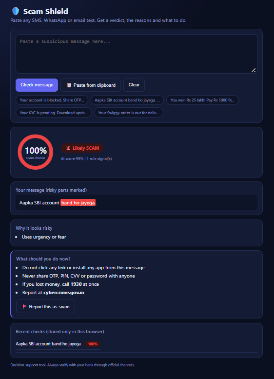
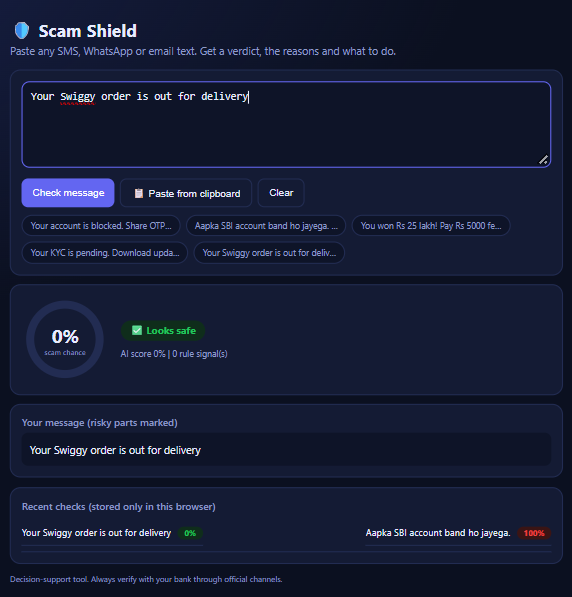

# 🛡️ AI Scam Detector

An explainable, AI-driven tool that checks suspicious messages (SMS, WhatsApp, email) for scam patterns, with a focus on **Indian scams and Hinglish**. Built for the Rakshan Hackathon.

## The problem
Scams like fake KYC, UPI refund fraud, lottery/KBC, fake job offers, "digital arrest", toll/challan fraud and courier/customs fraud keep changing their wording and links. Fixed blocklists miss new ones, many tools don't explain *why* a message is risky, and many victims are first-time smartphone users.

## What it does
Paste a message (or copy it) and get:
- A verdict: **SCAM / SUSPICIOUS / SAFE** with a percentage score
- **Reasons** in plain language (urgency, OTP request, fake officer, fee demand, gift cards...)
- **Risky words highlighted** in the message
- **Link checker**: shortened links, risky endings, fake bank-like domains, APK downloads, and disguised links such as `hxxp://bit[dot]ly`
- **What to do next**: 1930 helpline and cybercrime.gov.in
- A **report button** for scams the tool missed
- A **JSON API** (`/check`) so a mobile app can use the same brain
- A **desktop watcher** that pops up an alert when you copy a scam message




## How it works
```
Message -> TF-IDF (character n-grams, handles Hinglish spellings)
        -> Linear classifier -> AI score
        -> Rule engine (9 scam signals) -> reasons + rule score
        -> Combined verdict + explanation
```

## Project files
| File | Purpose |
|---|---|
| `make_data.py` | Generates about 5 lakh synthetic training messages |
| `train.py` | Trains the model and prints an honest exam score |
| `engine.py` | Shared brain: combines model score and rules |
| `explain.py` | Rule signals, risky-word highlighting, link checker |
| `api.py` | Flask server: web UI, `/check` and `/report` |
| `index.html` | Modern web interface |
| `app.py` | Alternative Streamlit interface |
| `watcher.py` | Desktop pop-up alert for copied scam messages |
| `scam_data.csv` | 131 hand-written messages used as the test set |
| `model.pkl`, `vec.pkl` | The trained model |

## Results (honest numbers)
- Training data: 5 lakh synthetic messages generated from scam and safe patterns (2 lakh used for training), plus 38 messages reworded from public scam examples
- Test: model trained **only on generated data**, tested on **131 hand-written messages it never saw**: **96.2% accuracy** (scam recall 100%, safe recall 93%)
- Limitation: the test set is small and worded similarly to the generated data, so real-world accuracy will likely be lower. Treat 96% as indicative, not a guarantee.

## Run it
```bash
pip install -r requirements.txt
python make_data.py      # builds big_data.csv (about 5 lakh messages, takes a few minutes)
python train.py          # trains and saves model.pkl, vec.pkl
python api.py            # then open http://localhost:8000 for the web UI
python watcher.py        # desktop pop-up alert for copied scam messages
python -m streamlit run app.py     # optional: Streamlit version
```

API example:
```bash
curl -X POST http://localhost:8000/check -H "Content-Type: application/json" -d "{\"text\": \"Your account is blocked. Share OTP now\"}"
```

Example response:
```json
{"verdict": "SCAM", "scam_percent": 91, "ai_percent": 77,
 "reasons": ["Uses urgency or fear", "Asks for private information (OTP, PIN, CVV, password)"],
 "links": []}
```

## How it differs from network-level filters
It works on any message from any app and any network,